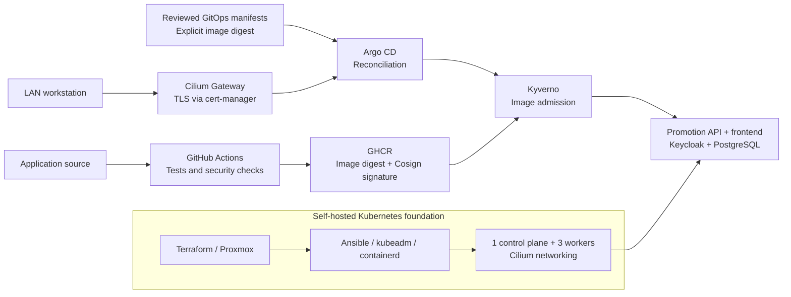

# Homelab V2 | DevSecOps & Platform Engineering

[](https://github.com/abdelhaouari/homelab-v2/actions/workflows/ci.yml)

**From virtual machines to signed application delivery: a self-hosted Kubernetes platform built and operated as code.**

I built this homelab to put enterprise platform engineering practices into
operation: automate infrastructure, deliver an authenticated application,
establish trust in its container images, and enforce that trust at the
Kubernetes boundary. The repository connects those layers through working
code, versioned configuration, and documented validation.

Terraform and Ansible provision the foundation on Proxmox. GitHub Actions
tests and scans the application, publishes it to GHCR, and signs its digest
with Cosign. Argo CD reconciles reviewed manifests, while Kyverno checks
image trust at admission. Cilium provides networking and a shared LAN
Gateway; cert-manager issues the certificate used for Argo CD HTTPS access.

**Validated on October 31, 2026:** 4 Kubernetes nodes `Ready` · 7 Argo CD
Applications `Synced/Healthy` · application, identity provider, and database
running in Kubernetes · Argo CD accessible over LAN HTTPS.

## What this project demonstrates

| Engineering area | Implemented capability | Explore the implementation |
| --- | --- | --- |
| Infrastructure automation | Four Ubuntu VMs provisioned with static addressing, VLAN attachment, cloud-init, and a pinned Proxmox provider | [Terraform](terraform/cluster-vms.tf) |
| Kubernetes operations | Version-pinned kubeadm cluster, containerd, guarded initialization, worker joining, and repeatable configuration | [Ansible workflow](ansible/site.yml) |
| Secure delivery | Secret scanning, SAST, dependency audits, container tests, vulnerability gates, GHCR publication, and keyless signing | [CI workflow](.github/workflows/ci.yml) · [Delivery design](docs/delivery.md) |
| GitOps platform management | App-of-apps reconciliation, scoped AppProjects, self-healing, and explicit resource ownership | [GitOps](gitops/README.md) |
| Software supply chain security | Digest-pinned workloads and admission policies checking the application's CI signing identity, including init and ephemeral containers | [Kyverno policies](gitops/manifests/kyverno-policies/) · [Security evidence](docs/container-security.md) |
| Networking and TLS | Cilium eBPF Service handling, VXLAN, Gateway API, LAN address announcements, and ACME DNS-01 with Cloudflare | [Architecture](docs/architecture.md) · [Gateway](gitops/manifests/shared-gateway/README.md) |
| Application security | FastAPI, Keycloak OIDC with PKCE, API role enforcement, separation of requester and approver, and PostgreSQL integrity controls | [Application](docs/application.md) |
| Operational validation | Connectivity tests, admission allow/deny tests, database persistence checks, and documented recovery gaps | [Validation record](docs/validation.md) · [Rebuild guide](docs/rebuild.md) |

## How the platform fits together



Image publication and deployment are separate steps. Updating the
application's image digest in Git selects the release Argo CD deploys.
The CI workflow does not use the cluster's administrator kubeconfig.

## A real application to exercise the platform

The **artifact promotion application** gives the infrastructure a concrete
workload and security model. Developers submit an image digest for staging;
another user approves or rejects the request; readers inspect the result.

- The browser and CLI authenticate through Keycloak using Authorization
  Code with PKCE S256. The API verifies access-token signatures and claims.
- The API enforces reader, developer, and approver permissions, including
  a ban on deciding one's own request.
- PostgreSQL uses a restricted application account, column permissions,
  constraints, and conditional updates to protect records and handle
  competing decisions.
- The API and compiled frontend share a non-root application image with
  a read-only root filesystem, dropped capabilities, and health probes.

The complete browser workflow has been exercised in Kubernetes. The
application records approval decisions; connecting those decisions to an
automated deployment is a future extension. Its current browser access
uses localhost port-forwards; LAN HTTPS currently serves Argo CD.

## Security controls with observable results

| Scenario | Recorded result |
| --- | --- |
| Signed application image from the accepted CI identity | Allowed by admission |
| Unsigned image or incorrect expected signer identity | Denied by admission |
| Forbidden init or ephemeral container image | Denied by admission |
| Missing, expired, incorrectly signed, or wrong-audience API token | Rejected in automated authentication tests |
| Reader attempts a write; requester attempts a self-decision | Rejected by authorization rules |
| Two concurrent decisions for the same request | One decision committed; competing decision rejected |
| PostgreSQL Pod replaced while retaining its PVC | Persisted data retained |
| HTTP request to the Argo CD hostname | Redirected to HTTPS; HTTPS and browser login validated |

Admission tests used server-side dry-runs. Database, browser, and
connectivity checks have their own recorded scope. See the
[validation record](docs/validation.md) for evidence and remaining checks.

## Infrastructure at a glance

The lab runs on one Proxmox VE server with 64 GB RAM, a three-SSD ZFS
RAIDZ1 pool, and an OPNsense VM routing the Kubernetes VLAN.

| Node | Role | vCPU | RAM | Disk | Address |
| --- | --- | ---: | ---: | ---: | --- |
| `k8s-cp01` | Control plane | 2 | 4 GiB | 60 GiB | `10.10.20.11` |
| `k8s-worker01` | Worker | 2 | 8 GiB | 80 GiB | `10.10.20.21` |
| `k8s-worker02` | Worker | 2 | 8 GiB | 80 GiB | `10.10.20.22` |
| `k8s-worker03` | Worker | 2 | 8 GiB | 80 GiB | `10.10.20.23` |

The cluster uses Kubernetes `1.36.5`, containerd `2.2.1`, and Cilium
`1.20.4`. Argo CD `3.5.6`, Kyverno `1.19.2`, and cert-manager `1.21.3`
provide delivery and platform controls. These are the deployed versions;
the [architecture document](docs/architecture.md) explains their ownership
and configuration.

## Explore the repository

```text
.
├── terraform/             # Proxmox VM lifecycle and cloud-init inputs
├── ansible/               # Host configuration, Kubernetes bootstrap, Cilium
├── app/                   # API, frontend, OIDC clients, SQL, tests, container
├── .github/workflows/     # Application and GitOps validation pipeline
├── ci/                    # Manifest validator, rejection tests, local schemas
├── gitops/                # Argo CD bootstrap, projects, applications, manifests
├── kubernetes/            # Platform Helm values, CRDs, storage, smoke tests
└── docs/                  # Architecture, delivery, evidence, operating guides
```

Start with [architecture](docs/architecture.md) for the system design,
[secure delivery](docs/delivery.md) for the path from commit to admission,
or [application security](docs/application.md) for the workload design.
To operate the lab, use the [rebuild guide](docs/rebuild.md),
[GitOps guide](gitops/README.md), and
[Proxmox bootstrap notes](docs/proxmox-bootstrap.md).

## Next engineering milestones

1. Extend LAN HTTPS to the application and Keycloak, including issuer and
   browser-client configuration.
2. Validate workload isolation with explicit NetworkPolicy allow/deny tests.
3. Protect state and application data off-host, then test restoration and
   a complete rebuild from fresh VMs.
4. Add platform observability and exercise node and Gateway failure scenarios.
5. Extend artifact evidence with SBOM/provenance and connect approved
   promotion decisions to a reviewed GitOps change.

## Operating scope

This is a personal lab applying enterprise engineering practices. All
nodes share one physical host, the control plane is a single instance,
and local-path storage does not replicate data. High availability and
disaster recovery remain development goals.

Secrets are provisioned outside Git; external or encrypted secret
management remains to be implemented. Image scanning uses documented,
package-scoped exceptions with a review deadline. The
[security assessment](docs/container-security.md) and
[validation record](docs/validation.md) make those boundaries explicit.
