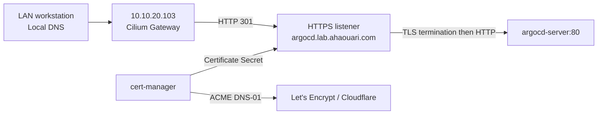

# Architecture

## Purpose and current state

This homelab provides a practical foundation for infrastructure automation,
Kubernetes operations, application delivery, and platform security.

The current deployment consists of one control plane and three workers
running on Proxmox VE. Terraform provisions the VMs, cloud-init establishes
guest access and addressing, and Ansible configures the hosts and
Kubernetes packages.

All four nodes reported Ready during the October 31, 2026 review. Cilium
provides Service handling without kube-proxy, and a functional smoke test
previously verified DNS, cross-node pod communication, and Service access.

The platform now runs the promotion API and compiled frontend, Keycloak,
and PostgreSQL under Argo CD. GitHub Actions tests, scans, publishes, and
signs the application image; Kyverno enforces image trust in `promotion`.
A shared Cilium Gateway exposes Argo CD over LAN HTTPS with a certificate
issued through cert-manager and Cloudflare DNS-01.

All seven Argo CD Applications were Synced and Healthy. See the
[validation record](validation.md) for the observed state and the scope
of earlier functional tests.

## Physical infrastructure

| Component           | Configuration                           |
| ------------------- | --------------------------------------- |
| Hypervisor          | Proxmox VE 9.1.6                        |
| Processor           | Intel Xeon E5-1650 v3, 12 logical CPUs  |
| Memory              | 64 GB installed                         |
| Storage             | ZFS RAIDZ1 pool across three SSDs       |
| Router and firewall | OPNsense VM, version observed: 26.1.7_3 |
| Kubernetes guests   | Ubuntu Server 24.04.5 LTS               |

All VMs share the same physical server and storage pool. The design does
not provide physical redundancy.

The legacy Ubuntu template, VM 9000, is preserved but is not used to
provision the new cluster.

## VM allocation

| VM           |  ID | Role                     | vCPU |   RAM | System disk |
| ------------ | --: | ------------------------ | ---: | ----: | ----------: |
| opnsense     | 100 | Router and firewall      |    4 | 4 GiB |      32 GiB |
| k8s-cp01     | 201 | Kubernetes control plane |    2 | 4 GiB |      60 GiB |
| k8s-worker01 | 202 | Kubernetes worker        |    2 | 8 GiB |      80 GiB |
| k8s-worker02 | 203 | Kubernetes worker        |    2 | 8 GiB |      80 GiB |
| k8s-worker03 | 204 | Kubernetes worker        |    2 | 8 GiB |      80 GiB |

The Kubernetes VMs have 28 GiB of allocated memory. Including OPNsense,
the allocation totals 32 GiB of memory, 12 vCPU, and 332 GiB of virtual
disk capacity.

An initial allowance of 12 to 16 GiB is reserved in the capacity plan for
Proxmox and ZFS. This is a planning allowance, not a configured ARC limit.

Virtual CPUs share the physical processor. Virtual disk sizes do not
represent current physical consumption. Proxmox storage entries backed by
the same ZFS pool share its capacity.

Three workers provide a basis for testing replica placement and node
maintenance. Application availability during those operations has not yet
been demonstrated.

## Network architecture

### Infrastructure networks

| Network      | Range          | Purpose                                          |
| ------------ | -------------- | ------------------------------------------------ |
| Home network | 192.168.0.0/24 | Upstream connectivity and Proxmox administration |
| VLAN 10      | 10.10.10.0/24  | Management                                       |
| VLAN 20      | 10.10.20.0/24  | Kubernetes nodes                                 |
| VLAN 30      | 10.10.30.0/24  | Storage network zone                             |
| VLAN 40      | 10.10.40.0/24  | Lab network zone                                 |
| WireGuard    | 10.10.50.0/24  | VPN network                                      |

These network zones describe the existing layout. Their presence does not
prove that isolation policies have been enforced or tested.

Proxmox administration uses `192.168.0.199` on `vmbr0`.
The OPNsense WAN address is `192.168.0.210`.

Each Kubernetes VM has one VirtIO interface connected to `vmbr1`.
Proxmox applies VLAN tag 20; Ubuntu uses an untagged guest interface.

### Node addressing

| Node         | Address        | Gateway and DNS |
| ------------ | -------------- | --------------- |
| k8s-cp01     | 10.10.20.11/24 | 10.10.20.1      |
| k8s-worker01 | 10.10.20.21/24 | 10.10.20.1      |
| k8s-worker02 | 10.10.20.22/24 | 10.10.20.1      |
| k8s-worker03 | 10.10.20.23/24 | 10.10.20.1      |

Cloud-init configures these static addresses from Terraform.

The OPNsense DHCP pool is `10.10.20.200` through `10.10.20.250`.
The node addresses are outside that pool and do not require DHCP
reservations to prevent dynamic allocation.

### Kubernetes networks

| Network            | Range         | Management                               |
| ------------------ | ------------- | ---------------------------------------- |
| Pods               | 10.244.0.0/16 | Kubernetes allocates per-node CIDRs      |
| Services           | 10.96.0.0/16  | Kubernetes allocates virtual Service IPs |
| Cluster DNS domain | cluster.local | CoreDNS                                  |

The selected ranges do not overlap the documented infrastructure networks
or the WSL and node routes inspected during deployment. Routes introduced
by future VPN or cloud connections must be checked separately.

Observed PodCIDR assignments:

| Node         | PodCIDR       |
| ------------ | ------------- |
| k8s-cp01     | 10.244.0.0/24 |
| k8s-worker01 | 10.244.2.0/24 |
| k8s-worker02 | 10.244.1.0/24 |
| k8s-worker03 | 10.244.3.0/24 |

These assignments are observations from this deployment. A rebuild may
allocate the per-node ranges in a different order.

## Kubernetes and runtime configuration

| Component               | Configuration                              |
| ----------------------- | ------------------------------------------ |
| Kubernetes              | v1.36.5                                    |
| Kubernetes APT packages | 1.36.5-1.1, held against ordinary upgrades |
| Bootstrap tool          | kubeadm                                    |
| Container runtime       | containerd 2.2.1                           |
| Runtime socket          | unix:///run/containerd/containerd.sock     |
| Cgroup driver           | systemd                                    |
| Swap                    | Disabled                                   |
| IPv4 forwarding         | Enabled                                    |
| API endpoint            | 10.10.20.11:6443                           |

The control plane runs etcd, kube-apiserver, kube-controller-manager, and
kube-scheduler as static pods managed by the kubelet.

The API endpoint points directly to the single control-plane VM.
There is no API load balancer or redundant control plane.

Worker joining uses short-lived bootstrap tokens generated on the control
plane. Sensitive command output is suppressed in Ansible. The playbook
checks for existing kubelet configuration before attempting a join and
verifies node registration through the API.

Registration alone does not prove node health. Readiness and workload
connectivity are checked separately.

## Cilium networking

Cilium 1.20.4 is installed through Helm with configuration stored in
`kubernetes/cilium/values.yml`.

| Setting                | Choice              |
| ---------------------- | ------------------- |
| Routing mode           | Tunnel              |
| Tunnel protocol        | VXLAN               |
| IP address management  | Kubernetes PodCIDRs |
| kube-proxy replacement | Enabled             |
| Address family         | IPv4                |
| Operator replicas      | 2                   |

Each Cilium agent allocates pod addresses from its node's Kubernetes
PodCIDR. VXLAN encapsulates inter-node pod traffic using the VM network,
avoiding the need for pod-subnet routes in OPNsense.

VXLAN does not encrypt traffic. Workload encryption has not been configured.

Cilium replaces kube-proxy for Service networking. It connects directly
to the Kubernetes API at `10.10.20.11:6443`, independently of Service
routing. The kube-proxy DaemonSet and ConfigMap were removed, and
residual proxy rules were cleaned on all four nodes using the matching
kube-proxy version in cleanup mode. Kubelet-managed chains were retained.

Post-migration checks verified Service access from each node and DNS,
application health, readiness, unauthenticated access rejection, and
Keycloak discovery from the application Pod.

Cilium NetworkPolicy enforcement has not yet been exercised through
allow and deny tests.

OPNsense filters traffic that traverses the router. Traffic between VMs
on VLAN 20 can remain on the Proxmox bridge. Workload isolation therefore
requires controls at the Kubernetes or host boundary as appropriate.

Both CoreDNS replicas were observed on the same worker during initial
validation. DNS availability after losing that worker has not been tested.

## LAN access and certificate management

The shared Gateway requests `10.10.20.103`, outside the VLAN 20 DHCP pool.
Cilium LB IPAM assigns the address to its generated LoadBalancer Service;
the L2 announcement policy selects worker nodes on `eth0` to announce it.
The pool and policy select the label
`networking.ahaouari.com/exposure: lan-gateway`.

The Gateway lives in `ingress-system`. Its HTTP and hostname-specific
HTTPS listeners accept HTTPRoutes from `argocd` through an explicit
namespace selector. The HTTPS route forwards to `argocd-server:80`;
the HTTP route redirects the hostname to HTTPS with status 301.

cert-manager manages separate staging and production ClusterIssuers.
The production `argocd` Certificate writes `argocd-tls`, used by the
Gateway. `argocd-staging-tls` remains a separate test certificate.
The Cloudflare API token is provisioned outside Git.

The Argo CD Helm values configure its external URL and
`server.insecure=true` for HTTP behind the terminating Gateway.
Authentication remains enabled. Gateway-to-Argo-CD traffic is HTTP.
Local DNS is configured outside this repository; this setup provides
LAN access, with no configured public Internet exposure.

The promotion application and Keycloak still use localhost port-forwards.
Their issuer, frontend URL, and allowed redirects must change together
before extending the Gateway to them. Renewal and Gateway failover remain
unvalidated. See the [Gateway guide](../gitops/manifests/shared-gateway/README.md).

## Workloads, identity, and storage

The `promotion` namespace contains one API/frontend Deployment, one
Keycloak Deployment, and a single-instance PostgreSQL StatefulSet.
The API uses OIDC bearer tokens and application roles from Keycloak;
Keycloak stores identity data in its own PostgreSQL database and role.
The API connects through a separate restricted `promotion_app` role.

The API and PostgreSQL run as non-root users with read-only root
filesystems. All three workloads drop capabilities, disable privilege
escalation and ServiceAccount token automounting, and use
`RuntimeDefault` seccomp. Keycloak's root filesystem remains writable
for startup augmentation. Resource requests, limits, and startup,
readiness, and liveness probes are versioned with each workload.

The local-path provisioner uses node-local storage, `WaitForFirstConsumer`,
and a `Retain` reclaim policy. PostgreSQL uses a 5 GiB PVC, additionally
marked `Prune=false,Delete=false` for Argo CD. Pod-replacement persistence
was tested. Neither retention setting replicates data or protects against
direct deletion, node/storage loss, or missing backups.

Database initialization runs only on an empty data directory. Keycloak's
realm import initializes a missing realm. These mechanisms do not migrate
an existing database, reconcile realm changes, or rotate credentials.
See [application design](application.md) and [GitOps operations](../gitops/README.md).

## Delivery and policy enforcement

GitHub Actions performs secret scanning, SAST, dependency audits,
application tests, container checks, and an image vulnerability gate.
On pushes to `main`, the application job publishes to GHCR and uses
Cosign to sign and verify the published digest with its OIDC identity.
Strict GitOps schema validation runs as a separate job.

Argo CD reconciles six child Applications from `main`, under the
`homelab-apps` root. AppProjects allow explicit resource types and
destinations for workloads, policies, address allocation, certificates,
the Gateway, and Argo CD routes. Automated sync and self-healing are
enabled; pruning is disabled throughout.

Kyverno checks application images against the exact CI signing identity
and accepts PostgreSQL and Keycloak only at explicitly allowed digests.
Separate policies cover ordinary/init containers and ephemeral-container
updates. They fail closed at admission; background evaluation is disabled.
The vendor-image allowlist does not verify vendor signatures.

Release selection is an explicit digest change in Git. The application's
human promotion decisions are not connected to deployment automation.
See [secure delivery](delivery.md) for job ordering and trust boundaries,
and [container security](container-security.md) for admission evidence.

## Automation boundaries

| Tool | Responsibility |
|---|---|
| Terraform | VM lifecycle, virtual hardware, and cloud-init inputs |
| cloud-init | Initial guest user, SSH key, and network configuration |
| Ansible | Host preparation, cluster bootstrap checks, worker joining, local access, and Cilium orchestration |
| kubeadm | Control-plane initialization and node joining |
| Helm | Cilium through Ansible; Argo CD, Kyverno, and cert-manager installed separately with versioned values |
| GitHub Actions | Source/dependency/image checks, application build, publication and signing, GitOps schema validation |
| Argo CD / Kustomize | Reconciliation of the application stack and selected platform resources |
| Kyverno | Image admission policies for `promotion` and the `signature-test` namespace |
| cert-manager | ACME account handling, DNS-01 challenges, certificate issuance and configured renewal |
| kubectl | Explicit bootstrap resources, readiness checks, and functional tests |

The official Ubuntu cloud image was verified against its signed checksum
manifest before import. Image preparation and Proxmox API permissions
remain administrative prerequisites.

The consolidated entry point, `ansible/site.yml`, executes:

1. Guest Agent configuration.
2. Operating system preparation.
3. containerd configuration.
4. Kubernetes package installation.
5. Control-plane initialization or verification.
6. Worker joining or registration verification.
7. Local administrator kubeconfig retrieval.
8. Cilium release management and readiness checks.

Local dependencies include the versioned Ansible collection requirements
and the helm-diff plugin. The rebuild procedure documents their setup.

The complete Ansible workflow was rerun against the existing cluster
with zero changes and no failures on all four nodes and localhost.
Package index refreshes remain time-dependent.

Control-plane initialization checks require either no detected markers
or the expected set of existing markers. Inconsistent state stops the
workflow. Existing control planes must also pass an API readiness check.

Worker joining checks local kubelet configuration and API registration.
These safeguards do not constitute automatic recovery from every partial
failure. No automatic cluster reset is performed.

Hubble TLS certificates use Cilium's CronJob generation method. This
avoids the changing certificate content produced by Helm-based generation
during repeated renders. The initial certificate Job completed, and a
subsequent Ansible run reported no changes. Scheduled renewal remains
untested.

The consolidated workflow has not yet been validated through a complete
rebuild from fresh VMs. It does not implement Kubernetes upgrades or
application data restoration.

Gateway API CRDs must be installed before the Cilium stage on a fresh
cluster. Argo CD, Kyverno, cert-manager, local-path storage, AppProjects,
namespaces, Secrets, and the root Application are separate bootstrap
responsibilities. `ansible/site.yml` does not install that entire platform.

See [rebuild.md](rebuild.md) for prerequisites, commands, and functional validation.

## Validation evidence

| Layer                 | Observed result                                                |
| --------------------- | -------------------------------------------------------------- |
| Provisioning          | Four Kubernetes VMs created through Terraform                  |
| Administration        | SSH and Ansible access succeeded on all four VMs               |
| Runtime               | containerd CRI plugins reported healthy                        |
| Host settings         | No active swap; IPv4 forwarding enabled                        |
| Packages              | kubeadm, kubelet, and kubectl installed at 1.36.5-1.1 and held |
| Cluster               | All four nodes reported Ready                                  |
| Networking components | Cilium agents, operators, and CoreDNS reported ready           |
| DNS                   | Test Service resolved to its ClusterIP                         |
| Cross-node traffic    | Direct pod HTTP request returned the expected response         |
| Service traffic       | HTTP through the Service name returned the expected response   |
| GitOps | Seven Applications Synced and Healthy in the October 31 review |
| Application stack | API, Keycloak, and PostgreSQL each ready; PostgreSQL PVC bound |
| Admission | Signed image allowed; unsigned and unauthorized images denied in recorded dry-run tests |
| LAN HTTPS | Production certificate issued; redirect, verified HTTPS, and browser login recorded |

The smoke test in `kubernetes/tests/network-smoke.yml` places a server on
`k8s-worker01` and a client on `k8s-worker02`.

Both HTTP paths returned `homelab-network-ok`. This is a targeted
functional test, not an exhaustive test of every node pair, protocol,
packet size, or failure scenario.

The scheduler and controller-manager each showed one restart during
initial deployment. Both were subsequently observed Ready; the cause of
those restarts has not been established.

## Security and operating limits

- All nodes depend on one physical server and one storage pool.
- The single control plane is a point of failure.
- Terraform has broad VM administration permissions, including OPNsense.
- The local administrator kubeconfig grants privileged cluster access.
- Secrets, kubeconfigs, Terraform state, and plans are excluded from Git.
- Terraform state is local; off-host state protection remains pending.
- Image admission is enforced; workload network isolation remains unverified.
- Secrets are provisioned outside Git; encrypted or external secret management is pending.
- Application image scanning has documented, expiring exceptions; vendor images are outside that scan scope.
- Node-local data does not survive loss of the underlying storage.
- Off-host backup and restore procedures have not been validated.
- Recreating infrastructure does not restore application data.

A Proxmox-generated cloud-init deprecation warning remains documented in
`proxmox-bootstrap.md`.

## Next architecture milestones

1. Extend LAN HTTPS to the application and Keycloak with consistent OIDC configuration.
2. Validate workload network isolation and operational failure scenarios.
3. Implement off-host state/data protection and test restoration.
4. Test the full bootstrap and application recovery path from fresh VMs.
5. Add observability, SBOM/provenance, and approval-driven release updates.
